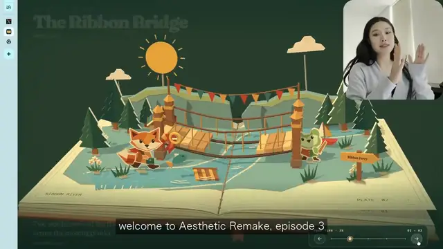

# Awesome Agent Showcase

<a href="https://heyatu.com/market?utm_source=github&amp;utm_medium=readme&amp;utm_campaign=market-hero"><picture><source media="(prefers-reduced-motion: reduce) and (max-width: 600px)" srcset="docs/readme/hero-narrow-still.jpg"><source media="(prefers-reduced-motion: reduce)" srcset="docs/readme/hero-still.jpg"><source media="(max-width: 600px)" srcset="docs/readme/hero-narrow.webp"></picture></a>

<p align="center">
<a href="https://heyatu.com?utm_source=github&amp;utm_medium=readme&amp;utm_campaign=badge-heyatu"></a> <a href="https://heyatu.com/market?utm_source=github&amp;utm_medium=readme&amp;utm_campaign=badge-market"></a> <a href="https://heyatu.com/download/mac?utm_source=github&amp;utm_medium=readme&amp;utm_campaign=badge-download"></a> <a href="https://heyatu.com/pricing?utm_source=github&amp;utm_medium=readme&amp;utm_campaign=badge-free-start"></a> <a href="https://github.com/heyatu/awesome-agent-showcase?utm_source=github&amp;utm_medium=readme&amp;utm_campaign=badge-licence#sources-and-rights"></a>
</p>

<p align="center">
<a href="#your-own-ai-on-your-own-computer">What is Hey Atu</a> · <a href="#install">Install</a> · <a href="#works-with-your-ai">Works with</a> · <a href="#ideas">Ideas</a> · <a href="#suggest-an-idea">Suggest an idea</a>
</p>

## Your own AI, on your own computer

**Hey Atu** runs [Pi](https://heyatu.com/faq) on your Mac or Linux computer, with your files, your tools and the model that you choose. Ask from wherever you are; the work continues when you walk away. Most ideas below open in Hey Atu with one press: a tested prompt where we ran it, and a prompt that we wrote where we did not.

| Works on your computer | Ask from anywhere | Any model you like |
| --- | --- | --- |
| Your files and tools, and your Hey Atu chats, stay on your computer. What the Hey Atu phone app and your computer send each other is end-to-end encrypted. An AI app such as ChatGPT or Claude calls from its own cloud, so its provider can read the results. | Ask in the Hey Atu app or the terminal. Or ask from ChatGPT, Claude, Codex or Claude Code (ChatGPT and Claude also work from their phone apps): the AI app does the task on your computer. | In the Hey Atu app and the terminal, sign in with your ChatGPT, Claude or Copilot plan, or bring an API key. 30 providers. |

## Install

| Where | How |
| --- | --- |
| [Mac app](https://heyatu.com/download/mac) | Download, open, done. macOS 13 or later, Apple silicon and Intel. |
| Terminal (Mac or Linux) | `curl -fsSL https://heyatu.com/install \| sh` |
| [ChatGPT, Claude, Codex, Claude Code](https://heyatu.com/ai-apps) | Add Hey Atu as a connector. The AI app does the task on your computer. |
| iPhone, iPad, Apple Watch | Coming soon. |

Then open any idea below and press **Run the tested version in Hey Atu**, or **Try it in Hey Atu** for a prompt that we wrote and did not run. The prompt opens as a draft; nothing runs until you send it. [Free start: 100 actions, no card.](https://heyatu.com/pricing)

## Works with your AI

<picture>
<source media="(max-width: 600px)" srcset="docs/readme/works-with-narrow.png">

</picture>

Logos are trademarks of their owners.

## Ideas

Each item has a short brief. Copy the brief into your own agent, or open the idea in Hey Atu with one press.

<!-- collection:start -->
<!-- Generated by scripts/readme.mjs. Edit entries or tags, then run it again. -->

### ★ Editor's Picks (3)

Aesthetic Remake: we rebuild projects we liked with one prompt.

<table>
<tr>
<td width="50%" valign="top">

<a href="https://heyatu.com/market/x-2122943582156034441?utm_source=github&amp;utm_medium=readme&amp;utm_campaign=market-grid"><picture><source media="(prefers-reduced-motion: reduce)" srcset="entries/x-2122943582156034441/media/footage-sorter-cover-still.webp"></picture></a>

<p><strong><a href="https://heyatu.com/market/x-2122943582156034441?utm_source=github&amp;utm_medium=readme&amp;utm_campaign=market-grid">Sort creator footage with a flying 3D ball</a></strong><br>Aesthetic Remake EP01: a viral camera-roll sorter rebuilt for video footage. Clips fly from a spinning ball of thumbnails into category cards.</p>

<p>★ Editor's Pick · Tested in Hey Atu</p>

<details>
<summary>Brief</summary>

```text
A local web tool that sorts a folder of video clips by what is in them: thumbnails form a slowly turning 3D ball, then each clip flies in an arc into its category card, with live counts and a pile of duplicates.
```

</details>

<p><a href="https://heyatu.com/market/x-2122943582156034441?utm_source=github&amp;utm_medium=readme&amp;utm_campaign=market-category">Run the tested version in Hey Atu →</a></p>

</td>
<td width="50%" valign="top">

<a href="https://heyatu.com/market/x-2124758346498715671?utm_source=github&amp;utm_medium=readme&amp;utm_campaign=market-grid"><picture><source media="(prefers-reduced-motion: reduce)" srcset="entries/x-2124758346498715671/media/pixel-trees-cover-still.webp"></picture></a>

<p><strong><a href="https://heyatu.com/market/x-2124758346498715671?utm_source=github&amp;utm_medium=readme&amp;utm_campaign=market-grid">Pixel trees that feel the wind</a></strong><br>Aesthetic Remake EP02: FeralUI's Pixel Play rebuilt with one prompt, then turned into wind chimes that ring in the breeze.</p>

<p>★ Editor's Pick · Tested in Hey Atu</p>

<details>
<summary>Brief</summary>

```text
A browser garden of three pixel-art trees built on bones: a tap makes one tremble and drop leaves, a pulled branch springs back, and a wind switch bends the crowns and strips leaves that later regrow.
```

</details>

<p><a href="https://heyatu.com/market/x-2124758346498715671?utm_source=github&amp;utm_medium=readme&amp;utm_campaign=market-category">Run the tested version in Hey Atu →</a></p>

</td>
</tr>
<tr>
<td width="50%" valign="top">

<picture><source media="(prefers-reduced-motion: reduce)" srcset="entries/x-2124758794630803753/media/pop-up-book-cover-still.webp"></picture>

<p><strong>A 3D pop-up storybook you flip by hand</strong><br>Aesthetic Remake EP03: The Folded Atlas rebuilt with one prompt, a pop-up book you flip by hand.</p>

<p>★ Editor's Pick · Tested in Hey Atu</p>

<details>
<summary>Brief</summary>

```text
A 3D pop-up storybook in the browser: an open book on a table whose pages you turn by hand while low-poly paper dioramas fold flat and rise again, with paper puppet characters that bob and small hidden tricks to click.
```

</details>

</td>
<td width="50%" valign="top">

</td>
</tr>
</table>

### Images (1)

<table>
<tr>
<td width="50%" valign="top">

<a href="https://heyatu.com/market/x-2096571444058894446?utm_source=github&amp;utm_medium=readme&amp;utm_campaign=market-grid"><picture><source media="(prefers-reduced-motion: reduce)" srcset="entries/x-2096571444058894446/media/cover-still.webp"></picture></a>

<p><strong><a href="https://heyatu.com/market/x-2096571444058894446?utm_source=github&amp;utm_medium=readme&amp;utm_campaign=market-grid">Turn a photo into a halftone collage</a></strong><br>Keep the photograph above. Rebuild the same moment below with torn paper, tiny type and dots of ink.</p>

<p>via <a href="https://x.com/Hamburgerai/status/2096571444058894446">@Hamburgerai</a> · Tested in Hey Atu</p>

<details>
<summary>Brief</summary>

```text
Turn my portrait into a travel print with the colour photograph above a close-up made of torn scraps, halftone dots and rows of punctuation below.
```

</details>

<p><a href="https://heyatu.com/market/x-2096571444058894446?utm_source=github&amp;utm_medium=readme&amp;utm_campaign=market-category">Run the tested version in Hey Atu →</a></p>

</td>
<td width="50%" valign="top">

</td>
</tr>
</table>

### Animation and video (14)

<table>
<tr>
<td width="50%" valign="top">

<a href="https://heyatu.com/market/x-2080977918914969636?utm_source=github&amp;utm_medium=readme&amp;utm_campaign=market-grid"><picture><source media="(prefers-reduced-motion: reduce)" srcset="entries/x-2080977918914969636/media/cover-still.webp"></picture></a>

<p><strong><a href="https://heyatu.com/market/x-2080977918914969636?utm_source=github&amp;utm_medium=readme&amp;utm_campaign=market-grid">A koi made of 10,000 dots</a></strong><br>One short formula draws a koi that swims forever.</p>

<p>via <a href="https://x.com/yuruyurau/status/2080977918914969636">@yuruyurau</a> · Tested in Hey Atu</p>

<details>
<summary>Brief</summary>

```text
Draw a swimming koi from ten thousand white points on a dark canvas. Let its tail turn and its fins ripple in a continuous loop.
```

</details>

<p><a href="https://heyatu.com/market/x-2080977918914969636?utm_source=github&amp;utm_medium=readme&amp;utm_campaign=market-category">Run the tested version in Hey Atu →</a></p>

</td>
<td width="50%" valign="top">

<a href="https://heyatu.com/market/x-2103473953868063151?utm_source=github&amp;utm_medium=readme&amp;utm_campaign=market-grid"><picture><source media="(prefers-reduced-motion: reduce)" srcset="entries/x-2103473953868063151/media/badge-still.webp"></picture></a>

<p><strong><a href="https://heyatu.com/market/x-2103473953868063151?utm_source=github&amp;utm_medium=readme&amp;utm_campaign=market-grid">A badge unlock animation</a></strong><br>A trophy badge pops in, bursts with light rays and confetti, and settles with a glow, all on a web page.</p>

<p>via <a href="https://x.com/adriankuleszo/status/2103473953868063151">@adriankuleszo</a> · Tested in Hey Atu</p>

<details>
<summary>Brief</summary>

```text
A web page for an achievement unlocked: a trophy badge springs onto the screen, then rays, confetti and a lingering glow follow in that order, each with its own timing. A Replay button runs the sequence from the start every time, and everything is drawn in code.
```

</details>

<p><a href="https://heyatu.com/market/x-2103473953868063151?utm_source=github&amp;utm_medium=readme&amp;utm_campaign=market-category">Run the tested version in Hey Atu →</a></p>

</td>
</tr>
<tr>
<td width="50%" valign="top">

<a href="https://heyatu.com/market/x-2109112248832503895?utm_source=github&amp;utm_medium=readme&amp;utm_campaign=market-grid"><picture><source media="(prefers-reduced-motion: reduce)" srcset="entries/x-2109112248832503895/media/whip-pan-still.webp"></picture></a>

<p><strong><a href="https://heyatu.com/market/x-2109112248832503895?utm_source=github&amp;utm_medium=readme&amp;utm_campaign=market-grid">Name your camera moves</a></strong><br>Swap “make it look nice” for a named camera move, and give AI a shot to aim for.</p>

<p>via <a href="https://x.com/showheyohtaki/status/2109112248832503895">@showheyohtaki</a> · Tested in Hey Atu</p>

<details>
<summary>Brief</summary>

```text
A ten-second product promo that plays in the browser, built from three named camera moves: a dolly in that closes on the product, a rack focus that shifts what is sharp, and a whip pan that swings fast, with blur, into the end card. Use my product or invent a sample one, and give each move its own clear moment.
```

</details>

<p><a href="https://heyatu.com/market/x-2109112248832503895?utm_source=github&amp;utm_medium=readme&amp;utm_campaign=market-category">Run the tested version in Hey Atu →</a></p>

</td>
<td width="50%" valign="top">

<a href="https://heyatu.com/market/x-2119458988165370270?utm_source=github&amp;utm_medium=readme&amp;utm_campaign=market-grid"><picture><source media="(prefers-reduced-motion: reduce)" srcset="entries/x-2119458988165370270/media/wind-cover-still.webp"></picture></a>

<p><strong><a href="https://heyatu.com/market/x-2119458988165370270?utm_source=github&amp;utm_medium=readme&amp;utm_campaign=market-grid">Pixel Play Wind Garden</a></strong><br>Bend the wind and send pixel leaves tumbling.</p>

<p>via <a href="https://x.com/SolutionB2u/status/2119458988165370270">@SolutionB2u</a> · Tested in Hey Atu</p>

<details>
<summary>Brief</summary>

```text
An original pixel garden in the browser where the wind moves the leaves: chunky pixel trees bend in a breeze, leaves tumble off and pile up on the ground, and the wind can be reversed.
```

</details>

<p><a href="https://heyatu.com/market/x-2119458988165370270?utm_source=github&amp;utm_medium=readme&amp;utm_campaign=market-category">Run the tested version in Hey Atu →</a></p>

</td>
</tr>
<tr>
<td width="50%" valign="top">

<a href="https://heyatu.com/market/x-2119622784729096453?utm_source=github&amp;utm_medium=readme&amp;utm_campaign=market-grid"><picture><source media="(prefers-reduced-motion: reduce)" srcset="entries/x-2119622784729096453/media/volume-bar-cover-still.webp"></picture></a>

<p><strong><a href="https://heyatu.com/market/x-2119622784729096453?utm_source=github&amp;utm_medium=readme&amp;utm_campaign=market-grid">A volume bar with a resident</a></strong><br>Turn the volume up and a tiny pixel-art person wakes, reads, then covers their ears.</p>

<p>via <a href="https://x.com/Lattice_Node/status/2119622784729096453">@Lattice_Node</a> · Tested in Hey Atu</p>

<details>
<summary>Brief</summary>

```text
Make a wide pill-shaped volume slider in the browser whose knob is a glass bead that magnifies a pixel-art living room inside it. Dragging right brightens the room from night to day, wakes the person on the couch and makes them walk and cover their ears as sound waves grow, and ドン appears at the maximum.
```

</details>

<p><a href="https://heyatu.com/market/x-2119622784729096453?utm_source=github&amp;utm_medium=readme&amp;utm_campaign=market-category">Run the tested version in Hey Atu →</a></p>

</td>
<td width="50%" valign="top">

<a href="https://heyatu.com/market/x-2122849771954016572?utm_source=github&amp;utm_medium=readme&amp;utm_campaign=market-grid"><picture><source media="(prefers-reduced-motion: reduce)" srcset="entries/x-2122849771954016572/media/star-invite-cover-still.webp"></picture></a>

<p><strong><a href="https://heyatu.com/market/x-2122849771954016572?utm_source=github&amp;utm_medium=readme&amp;utm_campaign=market-grid">Star-morph wedding invitation</a></strong><br>A scroll-driven wedding invitation that uses a four-point star to transition between sections.</p>

<p>via <a href="https://x.com/s5style/status/2122849771954016572">@s5style</a> · Tested in Hey Atu</p>

<details>
<summary>Brief</summary>

```text
Design an invitation for an imaginary couple. Let scrolling reshape a blue star into a note card, then use a star-shaped wipe to reveal the next section. Build the look with lettering and geometry, without photos.
```

</details>

<p><a href="https://heyatu.com/market/x-2122849771954016572?utm_source=github&amp;utm_medium=readme&amp;utm_campaign=market-category">Run the tested version in Hey Atu →</a></p>

</td>
</tr>
<tr>
<td width="50%" valign="top">

<a href="https://heyatu.com/market/x-2122850545551479212?utm_source=github&amp;utm_medium=readme&amp;utm_campaign=market-grid"><picture><source media="(prefers-reduced-motion: reduce)" srcset="entries/x-2122850545551479212/media/night-dive-cover-still.webp"></picture></a>

<p><strong><a href="https://heyatu.com/market/x-2122850545551479212?utm_source=github&amp;utm_medium=readme&amp;utm_campaign=market-grid">Pixel night dive animation</a></strong><br>A tiny pixel swimmer dives into the dark and crawls up a river whose pattern changes as the swimmer moves.</p>

<p>via <a href="https://x.com/anikrisn/status/2122850545551479212">@anikrisn</a> · Tested in Hey Atu</p>

<details>
<summary>Brief</summary>

```text
Make a looping pixel-art canvas animation of a small red-suited swimmer who leaps into black space, splashes down and swims up a diagonal river seen in perspective. Leave a smeared rainbow reflection behind them, and cut the river surface to a new dithered green pattern every half second or so.
```

</details>

<p><a href="https://heyatu.com/market/x-2122850545551479212?utm_source=github&amp;utm_medium=readme&amp;utm_campaign=market-category">Run the tested version in Hey Atu →</a></p>

</td>
<td width="50%" valign="top">

<a href="https://heyatu.com/market/x-2122988750250901956?utm_source=github&amp;utm_medium=readme&amp;utm_campaign=market-grid"><picture><source media="(prefers-reduced-motion: reduce)" srcset="entries/x-2122988750250901956/media/prism-cover-still.webp"></picture></a>

<p><strong><a href="https://heyatu.com/market/x-2122988750250901956?utm_source=github&amp;utm_medium=readme&amp;utm_campaign=market-grid">Prismatic objects you can click</a></strong><br>Traditional objects drift in rainbow light on white. Click one to bring it up close and watch it turn.</p>

<p>via <a href="https://x.com/nono_ai_archive/status/2122988750250901956">@nono_ai_archive</a> · Tested in Hey Atu</p>

<details>
<summary>Brief</summary>

```text
Make a browser gallery with rainbow-glazed vessels floating under a wind bell. Let visitors pick a piece to see it turn against a blurred backdrop, then return to the gallery.
```

</details>

<p><a href="https://heyatu.com/market/x-2122988750250901956?utm_source=github&amp;utm_medium=readme&amp;utm_campaign=market-category">Run the tested version in Hey Atu →</a></p>

</td>
</tr>
<tr>
<td width="50%" valign="top">

<a href="https://heyatu.com/market/x-2123025365673050456?utm_source=github&amp;utm_medium=readme&amp;utm_campaign=market-grid"><picture><source media="(prefers-reduced-motion: reduce)" srcset="entries/x-2123025365673050456/media/robot-octopus-cover-still.webp"></picture></a>

<p><strong><a href="https://heyatu.com/market/x-2123025365673050456?utm_source=github&amp;utm_medium=readme&amp;utm_campaign=market-grid">Robot Octopus, Taken Apart</a></strong><br>A Three.js robotic glass octopus whose dome, eye, core and arms come apart at a click.</p>

<p>via <a href="https://x.com/dyfwsammy/status/2123025365673050456">@dyfwsammy</a> · Tested in Hey Atu</p>

<details>
<summary>Brief</summary>

```text
Code a 3D mechanical octopus that visitors can take apart in the browser. Give it a glass dome with glowing machinery and curled arms built from many white links. Add buttons that lift off single parts, plus one exploded view that spreads every piece out and puts it back.
```

</details>

<p><a href="https://heyatu.com/market/x-2123025365673050456?utm_source=github&amp;utm_medium=readme&amp;utm_campaign=market-category">Run the tested version in Hey Atu →</a></p>

</td>
<td width="50%" valign="top">

<a href="https://heyatu.com/market/x-2123083433744425116?utm_source=github&amp;utm_medium=readme&amp;utm_campaign=market-grid"><picture><source media="(prefers-reduced-motion: reduce)" srcset="entries/x-2123083433744425116/media/jelly-melon-cover-still.webp"></picture></a>

<p><strong><a href="https://heyatu.com/market/x-2123083433744425116?utm_source=github&amp;utm_medium=readme&amp;utm_campaign=market-grid">A jelly watermelon you can poke</a></strong><br>A jelly watermelon slice that wobbles when you click it and stretches when you pull it.</p>

<p>via <a href="https://x.com/vib3coded/status/2123083433744425116">@vib3coded</a> · Tested in Hey Atu</p>

<details>
<summary>Brief</summary>

```text
A 3D watermelon wedge made of red jelly on a plain cream floor. It sways when clicked and stretches flat when pulled, then springs back and wobbles until it settles. No text on the page.
```

</details>

<p><a href="https://heyatu.com/market/x-2123083433744425116?utm_source=github&amp;utm_medium=readme&amp;utm_campaign=market-category">Run the tested version in Hey Atu →</a></p>

</td>
</tr>
<tr>
<td width="50%" valign="top">

<a href="https://heyatu.com/market/x-2123184113561817370?utm_source=github&amp;utm_medium=readme&amp;utm_campaign=market-grid"><picture><source media="(prefers-reduced-motion: reduce)" srcset="entries/x-2123184113561817370/media/cover-still.webp"></picture></a>

<p><strong><a href="https://heyatu.com/market/x-2123184113561817370?utm_source=github&amp;utm_medium=readme&amp;utm_campaign=market-grid">Kinetic motion reel in code</a></strong><br>Turn a product or mascot into a fast-cut Swiss-poster motion reel that plays right in your browser.</p>

<p>via <a href="https://x.com/chetaslua/status/2123184113561817370">@chetaslua</a></p>

<details>
<summary>Brief</summary>

```text
Build a 14-second, 13-cut Swiss-editorial kinetic motion reel in a single web page for my product or mascot, with bold condensed typography, a three-panel trick triptych, chromatic motion trails, a perspective grid lock-on and rapid gag cards.
```

</details>

<p><a href="https://heyatu.com/market/x-2123184113561817370?utm_source=github&amp;utm_medium=readme&amp;utm_campaign=market-category">Try it in Hey Atu →</a></p>

</td>
<td width="50%" valign="top">

<a href="https://heyatu.com/market/x-2123240616012226628?utm_source=github&amp;utm_medium=readme&amp;utm_campaign=market-grid"><picture><source media="(prefers-reduced-motion: reduce)" srcset="entries/x-2123240616012226628/media/jelly-scan-cover-still.webp"></picture></a>

<p><strong><a href="https://heyatu.com/market/x-2123240616012226628?utm_source=github&amp;utm_medium=readme&amp;utm_campaign=market-grid">Glowing jellyfish scan render</a></strong><br>A glowing sea-creature scan that glitches between a honeycomb shell, a blue jellyfish, an ASCII silhouette and violet shards, with HUD labels.</p>

<p>via <a href="https://x.com/fredremotion/status/2123240616012226628">@fredremotion</a> · Tested in Hey Atu</p>

<details>
<summary>Brief</summary>

```text
Make a looping Three.js render of a deep-sea creature built from glowing particles on black. Cut between a few looks, such as a hexagon shell, a see-through jellyfish and a text-character version, with a short glitch, and tag its parts with tiny monospace callouts.
```

</details>

<p><a href="https://heyatu.com/market/x-2123240616012226628?utm_source=github&amp;utm_medium=readme&amp;utm_campaign=market-category">Run the tested version in Hey Atu →</a></p>

</td>
</tr>
<tr>
<td width="50%" valign="top">

<a href="https://heyatu.com/market/x-2124758346498715671?utm_source=github&amp;utm_medium=readme&amp;utm_campaign=market-grid"><picture><source media="(prefers-reduced-motion: reduce)" srcset="entries/x-2124758346498715671/media/pixel-trees-cover-still.webp"></picture></a>

<p><strong><a href="https://heyatu.com/market/x-2124758346498715671?utm_source=github&amp;utm_medium=readme&amp;utm_campaign=market-grid">Pixel trees that feel the wind</a></strong><br>Aesthetic Remake EP02: FeralUI's Pixel Play rebuilt with one prompt, then turned into wind chimes that ring in the breeze.</p>

<p>★ Editor's Pick · Tested in Hey Atu</p>

<details>
<summary>Brief</summary>

```text
A browser garden of three pixel-art trees built on bones: a tap makes one tremble and drop leaves, a pulled branch springs back, and a wind switch bends the crowns and strips leaves that later regrow.
```

</details>

<p><a href="https://heyatu.com/market/x-2124758346498715671?utm_source=github&amp;utm_medium=readme&amp;utm_campaign=market-category">Run the tested version in Hey Atu →</a></p>

</td>
<td width="50%" valign="top">

<picture><source media="(prefers-reduced-motion: reduce)" srcset="entries/x-2124758794630803753/media/pop-up-book-cover-still.webp"></picture>

<p><strong>A 3D pop-up storybook you flip by hand</strong><br>Aesthetic Remake EP03: The Folded Atlas rebuilt with one prompt, a pop-up book you flip by hand.</p>

<p>★ Editor's Pick · Tested in Hey Atu</p>

<details>
<summary>Brief</summary>

```text
A 3D pop-up storybook in the browser: an open book on a table whose pages you turn by hand while low-poly paper dioramas fold flat and rise again, with paper puppet characters that bob and small hidden tricks to click.
```

</details>

</td>
</tr>
</table>

### Coding (11)

<table>
<tr>
<td width="50%" valign="top">

<a href="https://heyatu.com/market/x-2089289550958903358?utm_source=github&amp;utm_medium=readme&amp;utm_campaign=market-grid"><picture><source media="(prefers-reduced-motion: reduce)" srcset="entries/x-2089289550958903358/media/receipt-still.webp"></picture></a>

<p><strong><a href="https://heyatu.com/market/x-2089289550958903358?utm_source=github&amp;utm_medium=readme&amp;utm_campaign=market-grid">A receipt you tear off</a></strong><br>Pull the paper and watch the tear travel across: slow and clean, or quick and rough.</p>

<p>via <a href="https://x.com/marmobs/status/2089289550958903358">@marmobs</a> · Tested in Hey Atu</p>

<details>
<summary>Brief</summary>

```text
A web page where a printed shop receipt feeds out of a slot and you tear it off by dragging the paper. The tear starts at the corner nearest your grip and runs across: a slow pull cuts almost straight with fine serrations, a quick pull rips unevenly and leaves paper fibres. The torn piece curls and falls, and a Reprint button feeds the next receipt.
```

</details>

<p><a href="https://heyatu.com/market/x-2089289550958903358?utm_source=github&amp;utm_medium=readme&amp;utm_campaign=market-category">Run the tested version in Hey Atu →</a></p>

</td>
<td width="50%" valign="top">

<a href="https://heyatu.com/market/x-2093637541572612188?utm_source=github&amp;utm_medium=readme&amp;utm_campaign=market-grid"><picture><source media="(prefers-reduced-motion: reduce)" srcset="entries/x-2093637541572612188/media/cover-still.webp"></picture></a>

<p><strong><a href="https://heyatu.com/market/x-2093637541572612188?utm_source=github&amp;utm_medium=readme&amp;utm_campaign=market-grid">A bouquet that becomes a QR code</a></strong><br>Hide a link in a vase of flowers. A tap turns the bouquet into a code you can scan.</p>

<p>via <a href="https://x.com/ann_nnng/status/2093637541572612188">@ann_nnng</a> · Tested in Hey Atu</p>

<details>
<summary>Brief</summary>

```text
Make a flower gift with my link inside. Give the lilies a patterned vase and let the bouquet turn into a QR code when I tap it.
```

</details>

<p><a href="https://heyatu.com/market/x-2093637541572612188?utm_source=github&amp;utm_medium=readme&amp;utm_campaign=market-category">Run the tested version in Hey Atu →</a></p>

</td>
</tr>
<tr>
<td width="50%" valign="top">

<a href="https://heyatu.com/market/x-2095083470011945418?utm_source=github&amp;utm_medium=readme&amp;utm_campaign=market-grid"><picture><source media="(prefers-reduced-motion: reduce)" srcset="entries/x-2095083470011945418/media/cover-still.webp"></picture></a>

<p><strong><a href="https://heyatu.com/market/x-2095083470011945418?utm_source=github&amp;utm_medium=readme&amp;utm_campaign=market-grid">A photo hidden in a cloud of dots</a></strong><br>Turn a cube of coloured dots until a face looks back at you.</p>

<p>via <a href="https://x.com/x282665/status/2095083470011945418">@x282665</a> · Tested in Hey Atu</p>

<details>
<summary>Brief</summary>

```text
Build a puzzle that hides my photos in a cube and a sphere of coloured dots. Let me turn each cloud until the face appears, with gaps between the dots even when it lines up.
```

</details>

<p><a href="https://heyatu.com/market/x-2095083470011945418?utm_source=github&amp;utm_medium=readme&amp;utm_campaign=market-category">Run the tested version in Hey Atu →</a></p>

</td>
<td width="50%" valign="top">

<a href="https://heyatu.com/market/x-2098082543966867524?utm_source=github&amp;utm_medium=readme&amp;utm_campaign=market-grid"><picture><source media="(prefers-reduced-motion: reduce)" srcset="entries/x-2098082543966867524/media/cover-still.webp"></picture></a>

<p><strong><a href="https://heyatu.com/market/x-2098082543966867524?utm_source=github&amp;utm_medium=readme&amp;utm_campaign=market-grid">A retro boarding pass scanner</a></strong><br>Drag the pass through a beige reader: too fast is an error, steady gets you in.</p>

<p>via <a href="https://x.com/mjbarton_/status/2098082543966867524">@mjbarton_</a> · Tested in Hey Atu</p>

<details>
<summary>Brief</summary>

```text
Build a beige boarding pass scanner that reads a pass as I drag it through the slot. Reject a fast swipe with a red light and grant access on a steady swipe.
```

</details>

<p><a href="https://heyatu.com/market/x-2098082543966867524?utm_source=github&amp;utm_medium=readme&amp;utm_campaign=market-category">Run the tested version in Hey Atu →</a></p>

</td>
</tr>
<tr>
<td width="50%" valign="top">

<a href="https://heyatu.com/market/x-2103770889116627075?utm_source=github&amp;utm_medium=readme&amp;utm_campaign=market-grid"><picture><source media="(prefers-reduced-motion: reduce)" srcset="entries/x-2103770889116627075/media/dog-still.webp"></picture></a>

<p><strong><a href="https://heyatu.com/market/x-2103770889116627075?utm_source=github&amp;utm_medium=readme&amp;utm_campaign=market-grid">A character that follows your cursor</a></strong><br>Move the mouse and a cute character on a web page turns its eyes and head to follow it.</p>

<p>via <a href="https://x.com/himanshubuildss/status/2103770889116627075">@himanshubuildss</a> · Tested in Hey Atu · Claude Code</p>

<details>
<summary>Brief</summary>

```text
A web page with a friendly flat cartoon character whose eyes and head turn smoothly to follow the mouse pointer around the screen.
```

</details>

<p><a href="https://heyatu.com/market/x-2103770889116627075?utm_source=github&amp;utm_medium=readme&amp;utm_campaign=market-category">Run the tested version in Hey Atu →</a></p>

</td>
<td width="50%" valign="top">

<a href="https://heyatu.com/market/x-2111383736243859714?utm_source=github&amp;utm_medium=readme&amp;utm_campaign=market-grid"><picture><source media="(prefers-reduced-motion: reduce)" srcset="entries/x-2111383736243859714/media/cover-still.webp"></picture></a>

<p><strong><a href="https://heyatu.com/market/x-2111383736243859714?utm_source=github&amp;utm_medium=readme&amp;utm_campaign=market-grid">Fix the spacing in your app</a></strong><br>Make a cramped dashboard easier to scan without changing what it does.</p>

<p>via <a href="https://x.com/MichaelFilipiuk/status/2111383736243859714">@MichaelFilipiuk</a> · Tested in Hey Atu</p>

<details>
<summary>Brief</summary>

```text
Fix the spacing of an existing app and change nothing else. Set the sidebar width, add room above the content, tighten or loosen the gaps between cards and give each card comfortable inner padding, so a cramped screen is easy to scan. Every feature and every word of content stays as it is.
```

</details>

<p><a href="https://heyatu.com/market/x-2111383736243859714?utm_source=github&amp;utm_medium=readme&amp;utm_campaign=market-category">Run the tested version in Hey Atu →</a></p>

</td>
</tr>
<tr>
<td width="50%" valign="top">

<a href="https://heyatu.com/market/x-2122013352755126431?utm_source=github&amp;utm_medium=readme&amp;utm_campaign=market-grid"><picture><source media="(prefers-reduced-motion: reduce)" srcset="entries/x-2122013352755126431/media/whale-cove-still.webp"></picture></a>

<p><strong><a href="https://heyatu.com/market/x-2122013352755126431?utm_source=github&amp;utm_medium=readme&amp;utm_campaign=market-grid">A calm storybook game with a hand-painted feel</a></strong><br>A kid, a dog and a long way home: a gentle game that you play in your browser.</p>

<p>via <a href="https://x.com/Rubzem/status/2122013352755126431">@Rubzem</a> · Tested in Hey Atu · Fable 5.2</p>

<details>
<summary>Brief</summary>

```text
A gentle browser game where a child and a dog walk home across several scenes. Nothing is timed and nothing can go wrong. Each scene has a few things to discover, the look is soft and painterly, and the quiet sound is generated in code.
```

</details>

<p><a href="https://heyatu.com/market/x-2122013352755126431?utm_source=github&amp;utm_medium=readme&amp;utm_campaign=market-category">Run the tested version in Hey Atu →</a></p>

</td>
<td width="50%" valign="top">

<a href="https://heyatu.com/market/x-2123106462096654599?utm_source=github&amp;utm_medium=readme&amp;utm_campaign=market-grid"><picture><source media="(prefers-reduced-motion: reduce)" srcset="entries/x-2123106462096654599/media/fold-box-cover-still.webp"></picture></a>

<p><strong><a href="https://heyatu.com/market/x-2123106462096654599?utm_source=github&amp;utm_medium=readme&amp;utm_campaign=market-grid">Fold a design into a box</a></strong><br>Put a picture on a flat box template, fold it into 3D, spin it and open the lid.</p>

<p>via <a href="https://x.com/youraipulse/status/2123106462096654599">@youraipulse</a> · Tested in Hey Atu</p>

<details>
<summary>Brief</summary>

```text
A browser tool for packaging mockups: choose a box shape and size, put a picture on the flat template with its cut and fold lines, then fold it into a 3D box you can spin and open.
```

</details>

<p><a href="https://heyatu.com/market/x-2123106462096654599?utm_source=github&amp;utm_medium=readme&amp;utm_campaign=market-category">Run the tested version in Hey Atu →</a></p>

</td>
</tr>
<tr>
<td width="50%" valign="top">

<a href="https://heyatu.com/market/x-2123280359978942481?utm_source=github&amp;utm_medium=readme&amp;utm_campaign=market-grid"><picture><source media="(prefers-reduced-motion: reduce)" srcset="entries/x-2123280359978942481/media/keypad-3d-cover-still.webp"></picture></a>

<p><strong><a href="https://heyatu.com/market/x-2123280359978942481?utm_source=github&amp;utm_medium=readme&amp;utm_campaign=market-grid">3D macro keypad you can remap</a></strong><br>Spin and flip a glowing 3D macro keypad in the browser, then click a key to give it a new action.</p>

<p>via <a href="https://x.com/Linmiv/status/2123280359978942481">@Linmiv</a> · Tested in Hey Atu</p>

<details>
<summary>Brief</summary>

```text
Create an interactive Three.js model of a small programmable keypad in see-through peach acrylic with chunky keycaps, a dial and a knob. Let visitors flip it over by dragging, light a key in blue when they click it, and pick its action from a side panel.
```

</details>

<p><a href="https://heyatu.com/market/x-2123280359978942481?utm_source=github&amp;utm_medium=readme&amp;utm_campaign=market-category">Run the tested version in Hey Atu →</a></p>

</td>
<td width="50%" valign="top">

<a href="https://heyatu.com/market/x-2123457524070273426?utm_source=github&amp;utm_medium=readme&amp;utm_campaign=market-grid"><picture><source media="(prefers-reduced-motion: reduce)" srcset="entries/x-2123457524070273426/media/voice-wave-cover-still.webp"></picture></a>

<p><strong><a href="https://heyatu.com/market/x-2123457524070273426?utm_source=github&amp;utm_medium=readme&amp;utm_campaign=market-grid">Voice bar with rainbow dot wave</a></strong><br>A dark voice input bar with a rainbow dot wave for Listening and a teal sweep for Thinking.</p>

<p>via <a href="https://x.com/Jakubantalik/status/2123457524070273426">@Jakubantalik</a> · Tested in Hey Atu</p>

<details>
<summary>Brief</summary>

```text
Make a dark AI voice input panel for the browser whose lower edge carries a wave of tiny square dots. Let the dots swell into a bright rainbow hump while it listens, turn into a teal sweeping band while it thinks, and tilt the whole panel toward the pointer.
```

</details>

<p><a href="https://heyatu.com/market/x-2123457524070273426?utm_source=github&amp;utm_medium=readme&amp;utm_campaign=market-category">Run the tested version in Hey Atu →</a></p>

</td>
</tr>
<tr>
<td width="50%" valign="top">

<a href="https://heyatu.com/market/x-2123822724002853362?utm_source=github&amp;utm_medium=readme&amp;utm_campaign=market-grid"><picture><source media="(prefers-reduced-motion: reduce)" srcset="entries/x-2123822724002853362/media/frost-card-cover-still.webp"></picture></a>

<p><strong><a href="https://heyatu.com/market/x-2123822724002853362?utm_source=github&amp;utm_medium=readme&amp;utm_campaign=market-grid">Frosted wallet card animations</a></strong><br>A dark wallet card you can freeze under scrapeable frost, reveal, and shatter into grain on delete.</p>

<p>via <a href="https://x.com/sucodeee/status/2123822724002853362">@sucodeee</a> · Tested in Hey Atu</p>

<details>
<summary>Brief</summary>

```text
Make a dark phone wallet in the browser whose graphite card freezes under needle-like frost that the pointer can scrape away, reveals its number on demand, and crumbles into drifting grain when deleted before the next card slides in.
```

</details>

<p><a href="https://heyatu.com/market/x-2123822724002853362?utm_source=github&amp;utm_medium=readme&amp;utm_campaign=market-category">Run the tested version in Hey Atu →</a></p>

</td>
<td width="50%" valign="top">

</td>
</tr>
</table>

### Personal workflows (2)

<table>
<tr>
<td width="50%" valign="top">

<a href="https://heyatu.com/market/x-2097383854923538770?utm_source=github&amp;utm_medium=readme&amp;utm_campaign=market-grid"><picture><source media="(prefers-reduced-motion: reduce)" srcset="entries/x-2097383854923538770/media/press-still.webp"></picture></a>

<p><strong><a href="https://heyatu.com/market/x-2097383854923538770?utm_source=github&amp;utm_medium=readme&amp;utm_campaign=market-grid">My Morning Paper</a></strong><br>Read the day ahead like a newspaper, not a feed.</p>

<p>via <a href="https://x.com/karenxcheng/status/2097383854923538770">@karenxcheng</a> · Tested in Hey Atu</p>

<details>
<summary>Brief</summary>

```text
A printable front page of my day, styled as a vintage newspaper with a dated masthead and a typewriter-style reveal. It gathers what matters today from my calendar and messages, adds a weather line and one lead story, and fits a single A4 sheet.
```

</details>

<p><a href="https://heyatu.com/market/x-2097383854923538770?utm_source=github&amp;utm_medium=readme&amp;utm_campaign=market-category">Run the tested version in Hey Atu →</a></p>

</td>
<td width="50%" valign="top">

<a href="https://heyatu.com/market/x-2122943582156034441?utm_source=github&amp;utm_medium=readme&amp;utm_campaign=market-grid"><picture><source media="(prefers-reduced-motion: reduce)" srcset="entries/x-2122943582156034441/media/footage-sorter-cover-still.webp"></picture></a>

<p><strong><a href="https://heyatu.com/market/x-2122943582156034441?utm_source=github&amp;utm_medium=readme&amp;utm_campaign=market-grid">Sort creator footage with a flying 3D ball</a></strong><br>Aesthetic Remake EP01: a viral camera-roll sorter rebuilt for video footage. Clips fly from a spinning ball of thumbnails into category cards.</p>

<p>★ Editor's Pick · Tested in Hey Atu</p>

<details>
<summary>Brief</summary>

```text
A local web tool that sorts a folder of video clips by what is in them: thumbnails form a slowly turning 3D ball, then each clip flies in an arc into its category card, with live counts and a pile of duplicates.
```

</details>

<p><a href="https://heyatu.com/market/x-2122943582156034441?utm_source=github&amp;utm_medium=readme&amp;utm_campaign=market-category">Run the tested version in Hey Atu →</a></p>

</td>
</tr>
</table>

### Agent setup (1)

<table>
<tr>
<td width="50%" valign="top">

<a href="https://heyatu.com/market/x-2121392666244186327?utm_source=github&amp;utm_medium=readme&amp;utm_campaign=market-grid"><picture><source media="(prefers-reduced-motion: reduce)" srcset="entries/x-2121392666244186327/media/synthwave-still.webp"></picture></a>

<p><strong><a href="https://heyatu.com/market/x-2121392666244186327?utm_source=github&amp;utm_medium=readme&amp;utm_campaign=market-grid">Custom themes for Claude Code Desktop</a></strong><br>Describe the look. Claude Code Desktop builds the theme, backdrop and all.</p>

<p>via <a href="https://x.com/ClaudeDevs/status/2121392666244186327">@ClaudeDevs</a> · Claude Code</p>

<details>
<summary>Brief</summary>

```text
A Claude Code Desktop theme in a synthwave style: a striped sunset with a glowing grid as the animated backdrop, neon pink accents on the controls, and dark frosted glass behind the chat so the text stays easy to read. Build it as a mod that follows the official Claude Code mods documentation.
```

</details>

<p><a href="https://heyatu.com/market/x-2121392666244186327?utm_source=github&amp;utm_medium=readme&amp;utm_campaign=market-category">Try it in Hey Atu →</a></p>

</td>
<td width="50%" valign="top">

</td>
</tr>
</table>

<!-- collection:end -->

## Suggest an idea

[Suggest one result](https://github.com/heyatu/awesome-agent-showcase/issues/new?template=suggest-an-idea.yml) that Hey Atu can make. Link to any public source, or describe your own work. A maintainer reviews every suggestion. A suggestion does not publish anything.

Star this repository to see new items.

## Sources and rights

Each item credits and links its source. Quoted excerpts remain the author’s work. See [third-party rights](THIRD-PARTY.md) to request removal or [contributing](CONTRIBUTING.md) to suggest a correction.

The image at the top shows short excerpts of nine source posts, one in each tile, with credit on the tile: [@marmobs](https://x.com/marmobs/status/2089289550958903358) · [@karenxcheng](https://x.com/karenxcheng/status/2097383854923538770) · [@showheyohtaki](https://x.com/showheyohtaki/status/2109112248832503895) · [@MichaelFilipiuk](https://x.com/MichaelFilipiuk/status/2111383736243859714) · [@adriankuleszo](https://x.com/adriankuleszo/status/2103473953868063151) · [@ClaudeDevs](https://x.com/ClaudeDevs/status/2121392666244186327) · [@himanshubuildss](https://x.com/himanshubuildss/status/2103770889116627075) · [@Rubzem](https://x.com/Rubzem/status/2122013352755126431) · [@SolutionB2u](https://x.com/SolutionB2u/status/2119458988165370270). They stay the authors’ work.

Our code uses the [MIT licence](LICENSE). Our original text and assets, including the briefs, the badges, the works-with image and the layout of the top image, use [CC BY 4.0](LICENSE-CONTENT). Neither licence covers third-party work, including the excerpts in the top image.

## Repository

The [entry contract](docs/entry-contract.md) defines an item and its release record. [Purpose tags](tags/purposes.json) group items in the collection.

Use Node.js 24 or later. Run `node scripts/validate.mjs` to check the collection and `node scripts/readme.mjs` to rebuild the list.

Contribute an item → [CONTRIBUTING.md](CONTRIBUTING.md).
